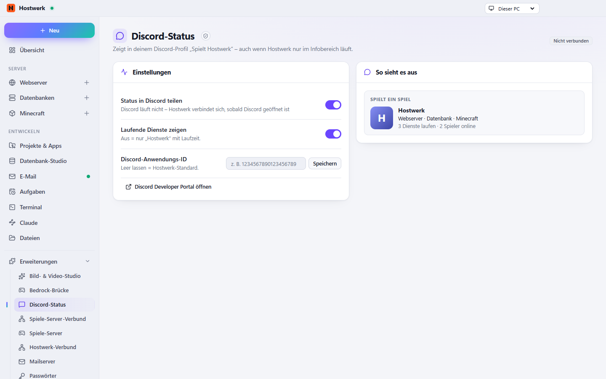

# Discord-Status

Zeigt „Spielt Hostwerk“ in deinem Discord-Profil – mit den Arten der laufenden Dienste, nie mit Projektnamen (einen Servernamen nur, wenn du ihn einschaltest).

[English](README.md) · Offizielle [Hostwerk](https://github.com/Passimoritz/hostwerk-public)-Erweiterung (SDK 2.7, native Erweiterung)



## Was sie kann

- Rich Presence mit den Arten der laufenden Dienste (Web, Datenbank, Minecraft …)
- Zeigt nie Namen von Projekten oder Ordnern
- Spricht direkt mit der Discord-App auf diesem PC – kein Internet nötig
- Vorschau des echten Status, Status-Punkt in der Seitenleiste
- Auf Wunsch: Spielerzahl, Name des Minecraft-Servers, ein Bild je Dienstart
- Knöpfe im Status: „Status ansehen“ (öffentliche Statusseite) und ein eigener Knopf
- Eigene Discord-App-ID möglich („Standard verwenden“ kehrt zurück)

Bilder je Dienstart: Discord zeigt nur Bilder, die in der Discord-Anwendung (der von Hostwerk oder deiner eigenen) unter den Namen `kind-web`, `kind-db`, `kind-mail`, `kind-app`, `kind-mc` und `kind-ai` hochgeladen sind (Rich Presence → Art Assets).

## Installieren

In Hostwerk unter **Erweiterungen → Entdecken** auf „Installieren“ klicken. Wer die Funktion schon in Hostwerk 2.8 benutzt hat, bekommt die Erweiterung beim Update automatisch – mit allen Daten.

Native Erweiterungen laufen als Teil von Hostwerk (eigener Server- und Oberflächen-Teil). Darum installiert Hostwerk sie nur aus dem offiziellen Katalog (mit Prüfsumme) oder im Entwickler-Modus.

## Daten

`settings.general.discord` – genau dort, wo Hostwerk sie schon immer abgelegt hat. Entfernen der Erweiterung löscht nichts.

## Entwickeln

```bash
node --test tests/*.test.js          # Tests
node build-native.js .               # Oberfläche bauen (sdk/build-native.js aus hostwerk-public)
node check.js . --strict             # Prüfung wie im Katalog (sdk/check.js)
```

Quelltext der Oberfläche in `ui/src`, Server-Teil in `server/`. Texte im Code sind Englisch, Deutsch steht in `locales/de.json`.

## Lizenz

MIT
