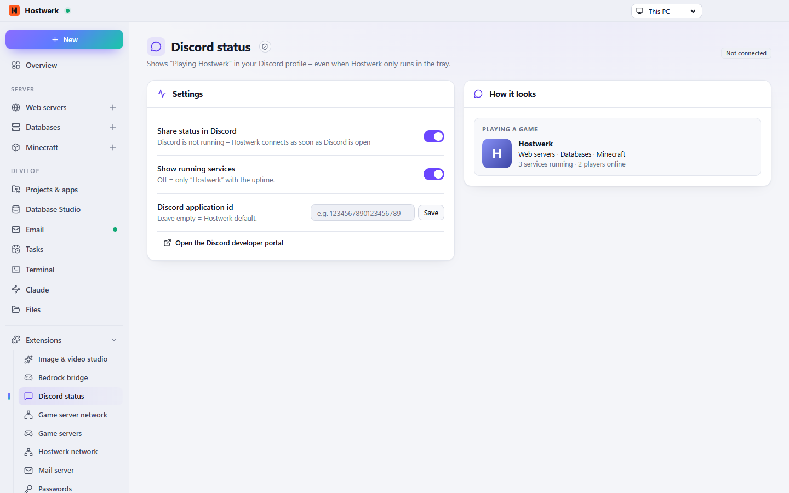

# Discord status

Shows “Playing Hostwerk” in your Discord profile – with the kinds of services that run, never project names (a server name only if you switch it on).

[Deutsch](README.de.md) · An official [Hostwerk](https://github.com/Passimoritz/hostwerk-public) extension (SDK 2.7, native extension)



## What it does

- Rich Presence with the kinds of running services (web, database, Minecraft …)
- Never shows names of projects or folders
- Talks directly to the Discord app on this PC – no internet needed
- Preview of the real status, status dot in the sidebar
- Optional: player count, Minecraft server name, one image per kind of service
- Buttons under the status: “View status” (public status page) and one own button
- Own Discord app id possible (“Use default” goes back)

Images per kind: Discord only shows images that are uploaded to the Discord application (Hostwerk’s or your own) under the names `kind-web`, `kind-db`, `kind-mail`, `kind-app`, `kind-mc` and `kind-ai` (Rich Presence → Art Assets).

## Install

In Hostwerk: **Extensions → Discover** and click “Install”. If you already used this feature in Hostwerk 2.8, the update installs the extension by itself – with all your data.

Native extensions run as part of Hostwerk (own server and interface part). That is why Hostwerk only installs them from the official catalogue (with checksum) or in developer mode.

## Data

`settings.general.discord` – exactly where Hostwerk always kept it. Removing the extension deletes nothing.

## Develop

```bash
node --test tests/*.test.js          # tests
node build-native.js .               # build the interface (sdk/build-native.js from hostwerk-public)
node check.js . --strict             # same check as the catalogue (sdk/check.js)
```

Interface source in `ui/src`, server part in `server/`. Texts in the code are English, German is in `locales/de.json`.

## License

MIT
